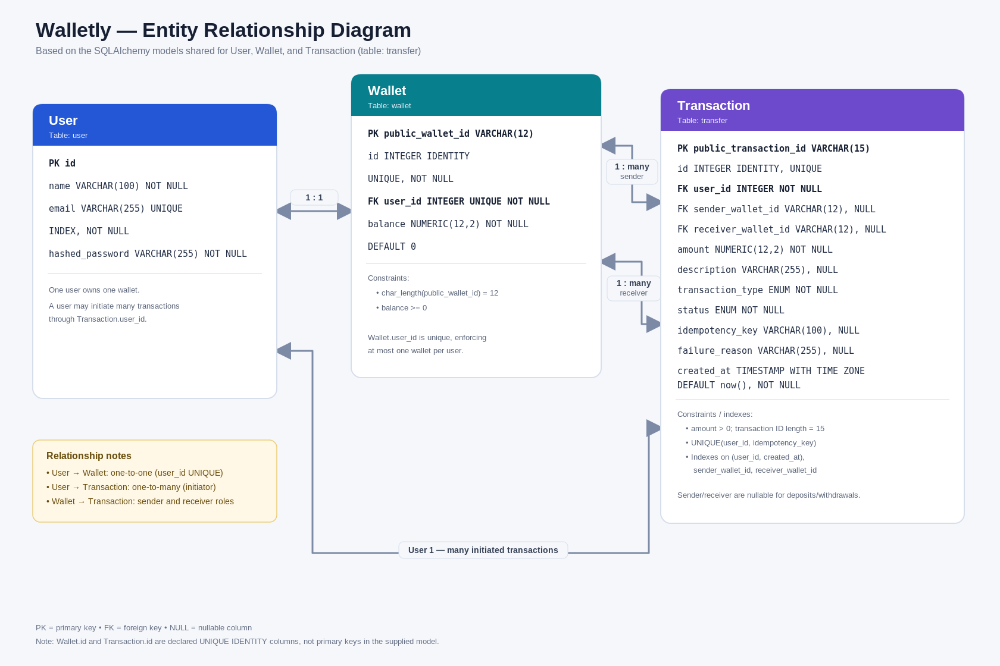

# Walletly — Digital Wallet & Money Transfer System

A full-stack digital wallet application built with **FastAPI, React, SQLAlchemy, and PostgreSQL**. The application supports user authentication, wallet balances, simulated deposits, withdrawals, wallet-to-wallet transfers, idempotency, and searchable transaction history.

The project focuses on financial business rules, database transactions, concurrency protection, API security, and automated testing.

## Features

### Authentication and Wallet Management
- User registration with password hashing.
- Login using JWT access and refresh tokens.
- Protected API endpoints.
- Automatic wallet creation during registration.
- Current user profile, public wallet ID, and wallet balance.
- Simulated deposits and withdrawals.

### Money Transfers
- Transfers between registered wallets.
- Positive amount validation and insufficient-balance handling.
- Database transactions for atomic balance updates and transaction records.
- Database row locking to protect against concurrent transfers.
- Idempotency keys to prevent duplicate transfer processing.
- Optional transfer descriptions.
- Recorded transaction status and failure reasons.

### Transaction Management
- Paginated transaction history.
- Search by transaction ID or wallet ID.
- Filtering by transaction type, status, direction, date range, and amount range.
- Sorting by supported fields and sort order.
- Individual transaction details.
- Authorization checks to restrict transaction access to involved wallet owners.

### Frontend
- Registration and login screens.
- Authenticated wallet dashboard.
- Deposit, withdrawal, and transfer forms.
- Transaction history, filters, sorting, and pagination.
- Transaction description and detail views.
- Loading, success, empty, and error states.

## Technology Stack

| Component | Technology |
|---|---|
| Frontend | React, JavaScript, Vite, CSS |
| Backend | Python, FastAPI |
| Database | PostgreSQL |
| ORM | SQLAlchemy |
| Request validation | Pydantic |
| Authentication | JWT access and refresh tokens |
| Password hashing | Passlib and bcrypt |
| Automated testing | Pytest, FastAPI TestClient, HTTPX |
| Linting | Ruff |
| Containerization | Docker, Docker Compose |
| API documentation | FastAPI Swagger UI / OpenAPI |

## Project Structure

```text
Walletly/
├── backend/
│   ├── main.py
│   ├── database.py
│   ├── databasemodel.py
│   ├── model.py
│   ├── auth.py
│   ├── security.py
│   ├── enums.py
│   ├── utils.py
│   ├── transfer_service.py
│   ├── wallet_service.py
│   ├── transaction_service.py
│   ├── requirements.txt
│   ├── requirements-dev.txt
│   ├── Dockerfile
│   └── tests/
├── frontend/
│   ├── src/
│   ├── public/
│   ├── package.json
│   ├── package-lock.json
│   └── Dockerfile
├── .env
├── .env.example
├── .gitignore
├── docker-compose.yml
└── README.md
```

### Backend Module Responsibilities

- `main.py`: FastAPI application setup, route definitions, dependencies, and HTTP handling.
- `database.py`: SQLAlchemy engine and database session factory.
- `databasemodel.py`: SQLAlchemy models and database constraints.
- `model.py`: Pydantic schemas for request validation and responses.
- `auth.py`: JWT authentication and token creation/verification.
- `security.py`: Password hashing and verification.
- `transfer_service.py`: Transfer business logic, locking, idempotency, and transactional processing.
- `wallet_service.py`: Deposit and withdrawal processing.
- `transaction_service.py`: Transaction search, filters, sorting, pagination, and details.
- `utils.py`: Public wallet ID and transaction ID generation.
- `enums.py`: Transaction types and statuses.

## Database Design

The application uses three primary tables.



### User
Stores user identity and authentication information.

- `id`: Primary key.
- `name`: User name.
- `email`: Unique email address.
- `hashed_password`: Hashed password, never the original plaintext password.

### Wallet
Stores a user's wallet and available balance.

- `public_wallet_id`: Public wallet identifier.
- `user_id`: Foreign key to the user; unique to enforce one wallet per user.
- `balance`: Non-negative monetary balance.

### Transaction
Stores deposit, withdrawal, and transfer records.

- `public_transaction_id`: Public transaction identifier.
- `user_id`: User who initiated the operation.
- `sender_wallet_id`: Sending wallet, nullable for deposits.
- `receiver_wallet_id`: Receiving wallet, nullable for withdrawals.
- `amount`: Positive transaction amount.
- `description`: Optional transaction description.
- `transaction_type`: Deposit, withdrawal, or transfer.
- `status`: Success or failure status.
- `idempotency_key`: Key used for transfer deduplication.
- `failure_reason`: Optional reason for failure.
- `created_at`: Transaction timestamp.

The database schema includes constraints for unique identifiers, one wallet per user, non-negative wallet balances, positive transaction amounts, and transfer idempotency-key uniqueness per initiating user.

## Prerequisites

For local development:

- Python 3.13 or another compatible Python version.
- Node.js and npm compatible with the frontend's Vite configuration.
- PostgreSQL.
- Git.

For containerized development:

- Docker Desktop.
- Docker Compose.

## Configuration and Secrets

Create a local `.env` file in the project root. Use `.env.example` as a template.

Example placeholder configuration:

```dotenv
POSTGRES_DB=walletly
POSTGRES_USER=walletly
POSTGRES_PASSWORD=replace_with_a_strong_password

ALGORITHM=HS256
SECRET_KEY=replace_with_a_random_secret
```

Replace every placeholder with an appropriate local value. These are examples, not production credentials.

The Docker Compose configuration uses these values to initialize PostgreSQL and configure the backend connection.

For local backend development, configure `backend/.env` with the required local `DATABASE_URL`, `TEST_DATABASE_URL`, `SECRET_KEY`, and `ALGORITHM` values.

The test database must be separate from both the development database and the Docker application's database.

**Never commit `.env` files, database passwords, JWT secrets, or real credentials to Git.** Keep `.env.example` limited to variable names and placeholder values.

## Running with Docker Compose

From the project root:

```powershell
cd D:\Walletly
docker compose config --quiet
docker compose up --build -d
```

Check the service status:

```powershell
docker compose ps
```

The Compose configuration runs:

- PostgreSQL as the `db` service.
- FastAPI as the `backend` service.
- React's production build served by Nginx as the `frontend` service.

### Application URLs

| Service | URL |
|---|---|
| React frontend | http://localhost:5173 |
| FastAPI API | http://localhost:8000 |
| Swagger API documentation | http://localhost:8000/docs |
| PostgreSQL on host | `localhost:5433` |

Inside the Docker network, FastAPI connects to PostgreSQL using the Compose service hostname `db` and port `5432`. From the host machine, PostgreSQL is published on port `5433`.

To view application logs:

```powershell
docker compose logs -f backend
```

To stop the services:

```powershell
docker compose down
```

**Warning:** `docker compose down -v` removes named volumes and can delete the Docker database's persisted data. Do not use it unless you intentionally want to remove the stored Docker database.

Docker's PostgreSQL initialization variables apply when the database data directory is first initialized. Changing the environment file later does not automatically change an existing database user's password.

## Running the Backend Locally

Open PowerShell:

```powershell
cd D:\Walletly\backend
python -m venv .venv
```

Activate the virtual environment:

```powershell
.\.venv\Scripts\Activate.ps1
```

Install the dependencies:

```powershell
python -m pip install -r requirements-dev.txt
```

Configure `backend/.env` with valid local PostgreSQL connection details and the required authentication settings.

Start FastAPI:

```powershell
python -m uvicorn main:app --reload
```

Local API documentation is available at:

http://127.0.0.1:8000/docs

Use a database appropriate for local development, not the automated test database.

## Running the Frontend Locally

Open a separate terminal:

```powershell
cd D:\Walletly\frontend
npm install
npm run dev
```

Open the URL printed by Vite, typically:

http://localhost:5173

For local development, configure the frontend's Vite API base URL to point to:

```text
http://localhost:8000
```

The production frontend container is built using the Vite API URL configured in the Dockerfile or Compose build arguments.

## API Reference

Protected endpoints require an access token in the header:

```http
Authorization: Bearer <access_token>
```

### Authentication

| Method | Endpoint | Description |
|---|---|---|
| POST | `/auth/register` | Register a user and create a wallet |
| POST | `/auth/login` | Authenticate and issue access and refresh tokens |
| POST | `/auth/refresh` | Issue a new access token using a refresh token |
| GET | `/users/me` | Retrieve the current user's profile and wallet ID |

### Wallet Operations

| Method | Endpoint | Description |
|---|---|---|
| GET | `/wallet` | Retrieve the current wallet and balance |
| POST | `/wallet/deposit` | Simulate depositing money |
| POST | `/wallet/withdraw` | Withdraw money from the current wallet |

Deposit and withdrawal requests accept a positive amount. The backend validates the request and updates the balance and transaction record.

### Transfers

| Method | Endpoint | Description |
|---|---|---|
| POST | `/transfers` | Transfer money to another wallet |

Example request:

```json
{
  "receiver_wallet_id": "A1B2C3D4E5F6",
  "amount": "250.00",
  "description": "Dinner payment"
}
```

Include the required idempotency header:

```http
Idempotency-Key: unique-key-for-this-transfer-attempt
```

Use the same key for retries of the same intended transfer. A key must not be reused for a different transfer request.

### Transaction History and Details

| Method | Endpoint | Description |
|---|---|---|
| GET | `/transactions` | List and filter transactions |
| GET | `/transactions/{id}` | Retrieve an individual transaction |

Supported history query parameters include:

- `page` and `limit`: Pagination.
- `search`: Search by transaction ID or wallet ID.
- `direction`: `sent` or `received`.
- `type`: Transaction type.
- `status`: Transaction status.
- `min_amount` and `max_amount`: Amount range.
- `start_date` and `end_date`: Date range.
- `sort_by`: A supported field such as `created_at`, `amount`, or `public_transaction_id`.
- `sort_order`: `asc` or `desc`.

The transaction service restricts history and transaction details to transactions involving the authenticated user's wallet.

The live Swagger UI at `/docs` provides the definitive request schemas and response definitions for the running application.

## Automated Tests

The project includes automated Pytest tests for registration, authentication, wallet operations, transfers, idempotency, rollback, authorization, and database configuration.

The currently established test suite contains 19 passing tests.

Run all tests from the backend directory:

```powershell
cd D:\Walletly\backend
python -m pytest -v
```

Run a particular test file:

```powershell
python -m pytest tests/test_transfer.py -v
```

Run code-quality checks:

```powershell
python -m ruff check . --select F401,F821
```

### Test Database Safety

Tests must run against the dedicated `wallet_test` PostgreSQL database. The test fixture clears test data to keep test cases isolated.

Before running tests, verify that the configured test URL and actual connected database both point to `wallet_test`. Never run the cleanup fixture against the development database or the Docker application's database.

The manual concurrency test script is separate from the automatically discovered Pytest suite and should be executed independently when the FastAPI server and appropriate test environment are running.

## Transaction and Security Considerations

- Passwords are hashed before storage.
- JWT authentication protects wallet and transaction endpoints.
- Wallet balances have a database-level non-negative constraint.
- Transfer processing locks wallet rows in a consistent order.
- Successful transfers debit the sender, credit the receiver, and create the transaction record within one database transaction.
- Idempotency keys prevent repeated processing of the same transfer.
- The backend applies authorization checks before returning a transaction's details.
- Input validation occurs on the backend; frontend validation is supplementary.

## Assumptions and Known Limitations

- Deposits are simulated. No external banking or payment-provider integration is implemented.
- The project is an engineering assignment and demonstration application, not a production banking platform.
- Production deployment would require a more comprehensive review of token storage, secret management, monitoring, auditability, rate limiting, backup/recovery, and database migrations.
- Database migrations should be used when changing existing schemas; SQLAlchemy `create_all()` does not update existing tables to add new columns.
- Failure handling around uncertain database commit outcomes requires careful reconciliation in a production financial system.
- The existing automated tests validate selected business and security cases; passing them does not prove every concurrency or failure scenario is safe.
- Docker Compose is configured for local development and demonstration. Production deployment requires environment-specific configuration and hardening.

## Demonstration Checklist

The following workflow demonstrates the application's main features
and important business rules.

1. Register two users and verify that each receives a wallet.
2. Log in and show the dashboard and available balance.
3. Deposit a simulated amount into the sender's wallet.
4. Transfer money to the second wallet with a description.
5. Verify the sender's and receiver's balances.
6. Open transaction history and view the transaction details.
7. Demonstrate insufficient-balance handling and verify that neither
   wallet balance changes.
8. Retry a transfer with the same idempotency key and verify that
   money is not transferred twice.
9. Attempt to access a transaction belonging to unrelated users
   and verify that access is rejected.
10. Run the automated test suite and show the results.


No open-source license has been specified; this project was developed for an engineering assignment.
